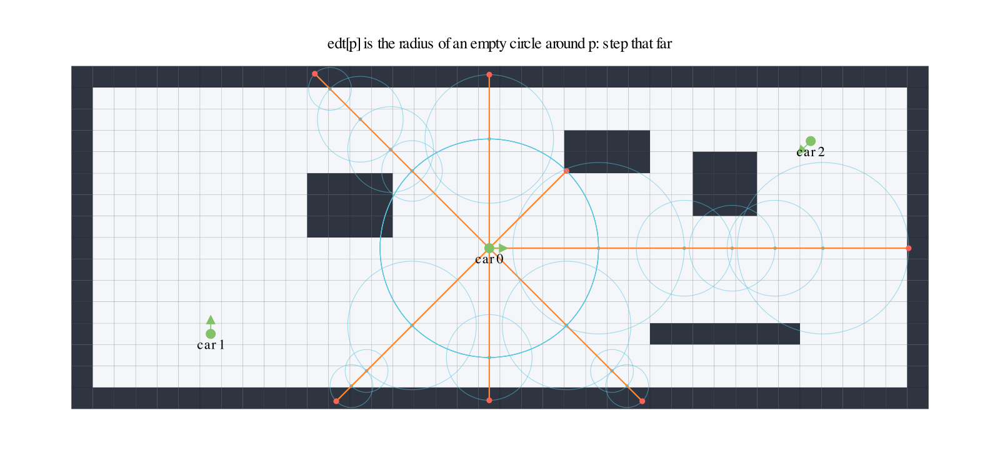
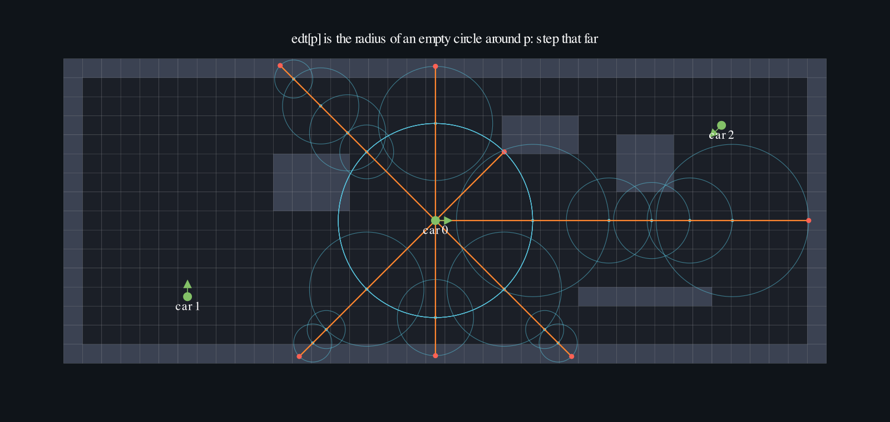

# Puzzle 1: Ray Marching

## Overview

A lidar is a fan of rays. Each ray leaves the sensor, travels until it hits a
wall, and reports how far it got. In [warporacer](https://github.com/uci-f1tenth/warporacer),
the GPU racing sim this lab is built from, every car reads a 108-beam scan
every step, and with 8k cars on the track that is close to a million rays per
step. The sim only works because the GPU does them all at once: one thread per
ray.

Implement a kernel that casts rays through a 2D occupancy grid and stores the
distance each ray travels before it hits a wall.

**Ray marching** finds that distance by walking along the ray in steps and
testing the map at each stop. The naive version takes fixed steps of one
pixel. **Sphere tracing** is the trick that makes it cheap: if you know the
distance from where you are to the nearest wall in _any_ direction, you can
safely step that far along the ray, because nothing can be closer. A
precomputed **distance field** (`edt`, for Euclidean distance transform) holds
exactly that number for every pixel, so each step is one lookup and most rays
finish in a handful of steps.

**Note:** _You have 1 thread per ray. The kernel loops, and the loop runs a
different number of times for every ray._




The map is a 40 x 16 occupancy grid, `#` for wall and `.` for drivable, with
the three cars marked where they sit. Car 0 faces right, car 1 faces up, car 2
faces down and to the left. Row 0 is the top of the image.

```txt
########################################
#......................................#
#......................................#
#......................####.......2....#
#......................####..###.......#
#..........####..............###.......#
#..........####..............###.......#
#..........####........................#
#..................0...................#
#......................................#
#......................................#
#......................................#
#.....1....................#######.....#
#......................................#
#......................................#
########################################
```

## Key concepts

- A data-dependent `while` loop inside a kernel, with early `break`
- Turning a floating point position into a `TileTensor` index
- One thread per (car, beam) with a 2D grid, and why beams of the same car
  should share a block
- Measuring the kernel at the scale the real sim runs at

For a ray starting at \\(p_0\\) with unit direction \\(d\\), repeat
\\[\Large p_{k+1} = p_k + d \cdot \text{edt}[p_k], \qquad \text{dist} = \sum_k \text{edt}[p_k]\\]
until \\(\text{edt}[p_k] = 0\\) (a wall pixel) or \\(\text{dist}\\) reaches the
lidar's range.

In pseudocode, one ray is:

```python
dist = 0
while dist < MAX_RANGE:
    step = edt[int(row), int(col)]   # px to the nearest wall, in any direction
    if step == 0:                     # standing in a wall pixel: that's the hit
        break
    col += d_col * step
    row += d_row * step
    dist += step
output[beam] = min(dist, MAX_RANGE)
```

This puzzle is split into three parts:

- [🔰 Sphere Tracing](./sphere_tracing.md) Start here: the marching loop and a
  fan of seven beams from one car.

- [⭐ Lidar Sweep](./lidar.md) Then give every car its own heading and run one
  thread per (car, beam), the way warporacer launches it.

- [📊 Benchmark: 8k Cars on Spielberg](./benchmark.md) Finally time the kernel
  you wrote at fleet scale on a real F1TENTH track, against the one-pixel
  stepper it replaces.
